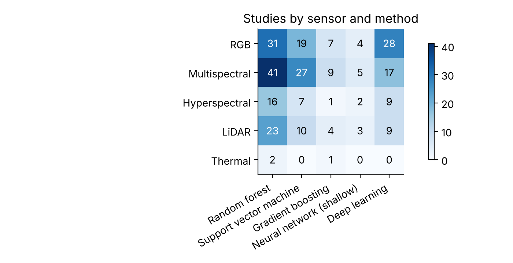
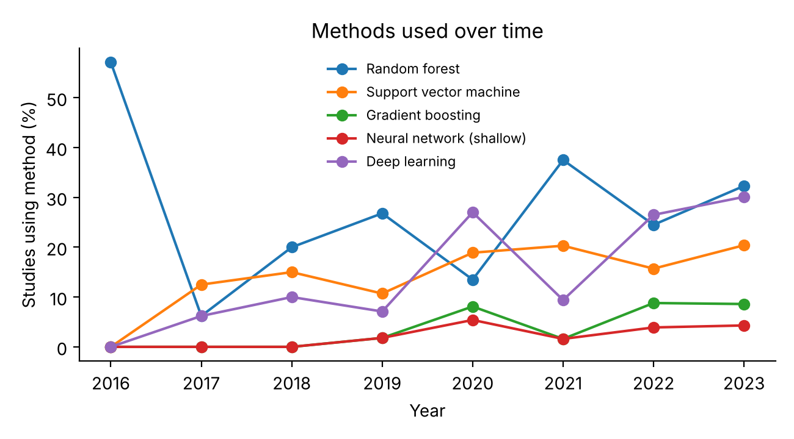
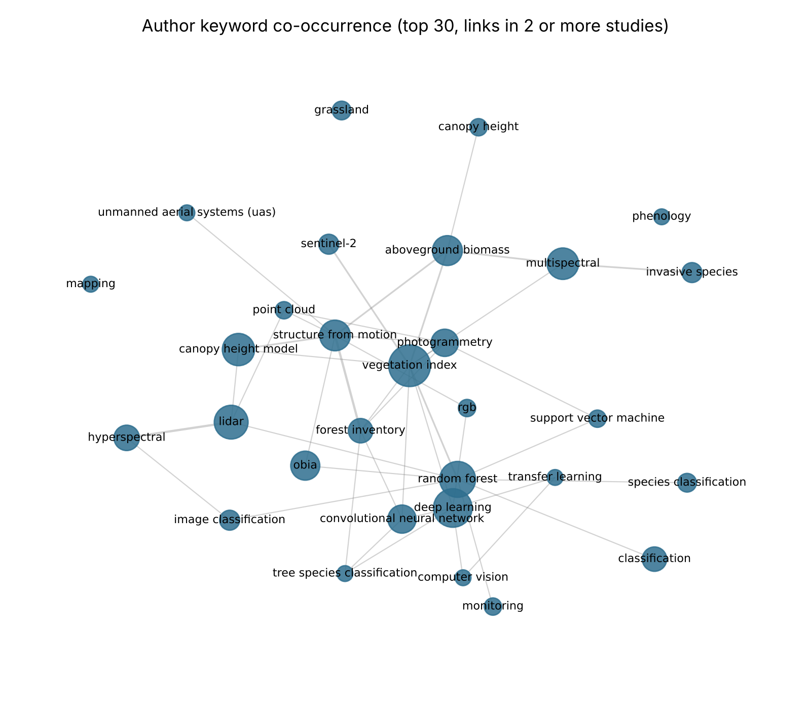

# UAV and machine learning in environmental remote sensing: a bibliometric map

A reproducible bibliometric analysis of 401 studies that combine drones (UAVs) with machine learning for environmental and ecological remote sensing. Related work: a review of sensor and actuator technologies for environmental UAV operations ([preprint](https://doi.org/10.20944/preprints202512.0048.v1)).



## Main patterns

* **Growth.** Studies rose from 20 in 2018 to 102 in 2022. The search was run in September 2023, so 2023 (93 studies) is a partial year.
* **Sensors.** RGB (109 studies) and multispectral (102) cameras dominate, followed by LiDAR (80) and hyperspectral (53). Thermal sensors appear in only 8 studies.
* **Methods.** Random forest is the most common method with multispectral and LiDAR data. Deep learning is used mostly with RGB imagery, probably because labelled RGB image sets are easier to build.
* **Trend.** Deep learning use varies from year to year (7% of studies in 2019, 27% in 2020, 9% in 2021) and reached 30% in 2023. Random forest was used in 25% to 38% of studies each year from 2021 to 2023.
* **Journals.** *Remote Sensing* published 109 of the 401 studies, followed by *Forests* (19) and *Ecological Indicators* (13).





## Method

1. Studies were screened in Rayyan and the included set was exported from Scopus.
2. Author keywords were lower-cased and merged across spellings (for example UAV, UAS, drone and RPAS become `uav`) using the table in `src/bibliometrics.py`.
3. Sensors, methods and application domains were flagged by regular expressions over title, abstract and keywords. A study can carry several flags.
4. The keyword network links the 30 most common keywords when they occur together in at least two studies. Generic terms (uav, remote sensing, machine learning) are left out.

All counts are in `outputs/tables/`.

## Run it

The Scopus export is not included because of Scopus terms of use. Export the included records from Scopus as CSV (all fields), save them as `data/raw/scopus_full_inclusion.csv`, then run:

```bash
pip install -r requirements.txt
python src/bibliometrics.py
pytest -q tests
```

## Author

Hammed Akano, Deakin University. MIT licence.
